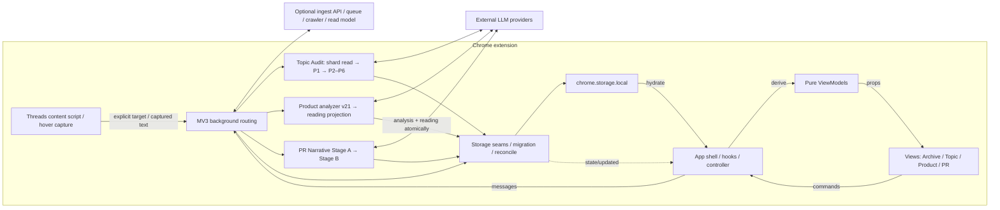

# DLens Architecture Map

核對日期：2026-09-07；工作版本 `0.3.61`，起點 `c43e93e`／`0.3.60`。這份地圖索引實際資料流、owner 與現有 guard，不是另一份產品規格或發布證明。本工作分支已完成工程 gate，尚未合併／發布或完成真實 runtime 驗收；結果見[固定 shared context](../memory/latest-shared-context.md)。整理前圖與 PR 日記已[逐字保存](../archive/2026-09-07-authority-consolidation/docs/architecture/dlens-current-architecture-map.md)。

流程讀 [CLAUDE.md](../../CLAUDE.md)，產品讀 [AGENTS.md](../../AGENTS.md)。當資料流或 owner 改變時更新此圖；historical roadmap 不決定當前排期。

## 狀態定義

- 🟩 Guarded：所列**特定 invariant** 有 test／guard；仍需在本次 revision 執行，不能外推為整個功能或 live runtime 不會出錯。
- 🟢 Implemented：程式路徑存在，有可查 owner；不要求所有行為已鎖定，也不冒充新 runtime 證據。
- 🟡 Partial／external risk：依賴不完整 capture、外部服務或仍有待驗證缺口。
- ⚪ External：不在 extension repo 控制內。

## 資料流

Background 是 extension MV3 service worker；私人 backend 是另一個 process。LLM calls 由 extension 的 provider seam 執行，user keys 留在本機。Views／ViewModels 的副作用限制由 [CLAUDE boundaries](../../CLAUDE.md#boundaries) 維護。

## Owner 與驗證入口

| 路徑／責任 | 程式 owner | 既有測試／guard | 證據邊界 |
|---|---|---|---|
| 🟢 Threads capture、explicit save target | [content script](../../entrypoints/threads.content.ts)、[background](../../entrypoints/background.ts) | [background behavior](../../tests/background-behavior.test.ts)、[pipeline trace boundary](../../tests/pipeline-trace-boundary.test.ts) | DOM／登入／reload 行為仍需真實 Threads |
| 🟢 Shell → ViewModel → View | [app state](../../src/ui/useInPageCollectorAppState.ts)、[controller](../../src/ui/controller.tsx)、[page registry](../../src/state/page-registry.ts) | [controller](../../tests/controller.test.ts)、[page registry](../../tests/page-registry.test.ts)、[Product routing](../../tests/product-routing.test.ts) | Source/DOM tests 不能證明 Chrome 載入版本 |
| 🟩 View／ViewModel wall | [View guard](../../scripts/check-view-boundary.mjs)、[VM guard](../../scripts/check-viewmodel-boundary.mjs) | `npm run boundary:guard` | 僅保證 guard 覆蓋的依賴與副作用限制 |
| 🟩 Storage writes／migration | [snapshot seam](../../src/state/snapshot-storage-seam.ts)、[schema registry](../../src/state/storage-schema.ts) | [seam guard](../../tests/seam-guard.test.ts)、[schema test](../../tests/storage-schema.test.ts)、`storage:seam-guard`／`storage:migrate-fixtures` | 僅保證登記 shape 與 fixture 覆蓋，不代表任意舊資料皆已實測 |
| 🟩 Scoped stale-response rejection／hydrate terminals | [request reconcile](../../src/state/request-reconcile.ts)、[controller](../../src/ui/controller.tsx) | [request reconcile](../../tests/request-reconcile.test.ts)、[background behavior](../../tests/background-behavior.test.ts)、[app state](../../tests/use-in-page-collector-app-state.test.ts) | 具體已測 target/request lane，非所有 race 的保證 |
| 🟢 Backend work projection | [coordinator](../../src/ui/useProcessingCoordinator.ts)、[controller response guard](../../src/ui/controller.tsx)、[processing state](../../src/state/processing-state.ts)、[work copy](../../src/state/backend-work-copy.ts) | [hook races](../../tests/controller-hook.test.tsx)、[processing state](../../tests/processing-state.test.ts)、[work copy](../../tests/backend-work-copy.test.ts) | API／worker／local AI／refresh 分開；unknown/unavailable 不投影 idle。`/health` 只證明 liveness；worker queue/result 另驗 |
| 🟢 Thread read-model projection | [captured post](../../src/state/captured-post.ts)、[ingest contract](../../src/contracts/ingest.ts) | [captured post fixtures](../../tests/captured-post.test.ts) | Backend／DOM capture 完整度仍為 🟡 |
| 🟩 Historical TRACE replay | [pipeline trace](../../src/state/pipeline-trace.ts)、[harness](../../scripts/qa-live-pipeline-harness.mjs) | [fixture gate](../../tests/qa-live-fixture-gate.test.ts)、`qa:harness:fixture` | 只重播既有 trace，不代表今天 live backend／LLM 成功 |

## Topic

[Handler](../../src/state/topic-audit-handlers.ts) 編排 captured evidence → P0.5 shard reading → bounded P1 → P2 lexicon／P3 narrative／P4 audience／P5 absence／P6 final。[Prompts](../../src/compare/topic-audit-prompts.ts)、[cache identity](../../src/compare/topic-audit-cache.ts)、[continuity](../../src/compare/topic-audit-continuity.ts) 與 [storage](../../src/state/topic-audit-storage.ts) 各自擁有純計算、重用、episode 與持久化責任。

- 🟢 `topic/audit/get` 在完整 inventory hydrate 後才協調 evidence，不生成或替換 memo/report/episode；running audit 使用共用 mutation queue。對應 [handler tests](../../tests/topic-audit-handlers.test.ts) 與 [hook tests](../../tests/use-topic-audit.test.tsx)。
- 🟩 Google Topic Audit envelope 自 `0.3.51` schema-free；[provider](../../src/compare/provider.ts) 的 parse＋一次 repair 由 [provider runtime tests](../../tests/provider-runtime.test.ts) 鎖定。此限制不適用於所有 Product Google schema。7/17 的 session／lease 設計仍有價值，只有強制 Google schema 分支被取代。
- 🟢 P0.5/P1 用 content／reference／provider／prompt identity 重用；aggregate lenses 隨 evidence-set 更新重跑。NarrativeState／episode revision 的證據見 [cache tests](../../tests/topic-audit-cache.test.ts)、[continuity tests](../../tests/topic-audit-continuity.test.ts)、[storage tests](../../tests/topic-audit-storage.test.ts)。
- 🟢 [TopicDetailView](../../src/ui/TopicDetailView.tsx) 維持穩定 Atlas、單一 source list／drawer；[compass VM](../../src/viewmodel/signal-atlas-compass.ts) 與 [compass tests](../../tests/signal-atlas-compass.test.ts) 處理 assignments。Reaction assignments 可重疊；圖示中的 assignment share 不能稱為互斥人物／留言人口比例。
- 🟡 Capture reservoir 可能不完整；P2–P6 不共用一個全局 input budget；P7 validator prompt 不是 handler 中已執行的 stage。模型判讀品質與外部 context 仍需個別證據。

## Product

[Analyzer v21](../../src/compare/product-signal-analysis.ts) 產生 axes 與 optional complete reading；[background](../../entrypoints/background.ts) 建立 source packet 後經 [reading projection](../../src/compare/product-analysis-reading.ts) 與 [atomic result storage](../../src/compare/product-analysis-result-storage.ts) 同步保存 analysis + SignalReading。

[Product VM](../../src/viewmodel/product-signal.ts) 做顯示投影；[Product views](../../src/ui/ProductSignalViews.tsx) 分開 Saved intake 與 Action 的 stage／brief／folder export。Action 不受 ambient current Threads post 限縮為 1/1；current reading 必須符合 context／prompt／source／refs identity。

卡片、brief 與 [packet](../../src/compare/signal-packet.ts) 共用 [reading identity gate](../../src/compare/product-reading-identity.ts)；[pure brief formatter](../../src/compare/product-agent-brief.ts) 保留完整 reading 及其 source packet，剪貼簿副作用由 [clipboard hook](../../src/ui/useAgentBriefClipboard.ts) 擁有。這條路徑不新增 provider call；stale／manual reading 仍是歷史，不冒充 current reading。

🟩 具體契約覆蓋：[analyzer](../../tests/product-signal-analysis.test.ts)、[provider](../../tests/provider-runtime.test.ts)、[storage](../../tests/product-signal-storage.test.ts)、[VM](../../tests/product-signal-viewmodel.test.ts)、[views](../../tests/views.test.tsx) 與 [routing](../../tests/product-routing.test.ts)。這些測試不能代替真實 copy 全文或卡片使用驗收。完整產品規則引用 [AGENTS](../../AGENTS.md#mode-contracts-current-history-and-rationale-in-the-archive)；未完成 business intake／manual loop 見[需求索引](product-decision-index.md)。

## PR Evidence 與 Narrative

[PR narrative handler](../../src/state/pr-narrative-handlers.ts) 以 campaign current main-post corpus 執行 Stage A per-chunk reading → Stage B synthesis，再由 [narrative storage](../../src/state/pr-narrative-storage.ts) 保存。來源 hash 在發布前重查；prose guard 與每 stage 最多一次 semantic repair 由 [contract tests](../../tests/pr-narrative-contract.test.ts)、[handler tests](../../tests/pr-narrative-handlers.test.ts) 及 [provider tests](../../tests/provider-runtime.test.ts) 覆蓋。

🟢 Evidence 六準則／CSV 與 Narrative 是不同 lens。Narrative 不代表 discovery、monitoring、comment reading 或跨時間趨勢；舊 V1 brief 的限制需按 lens 理解，不能取代根契約。
